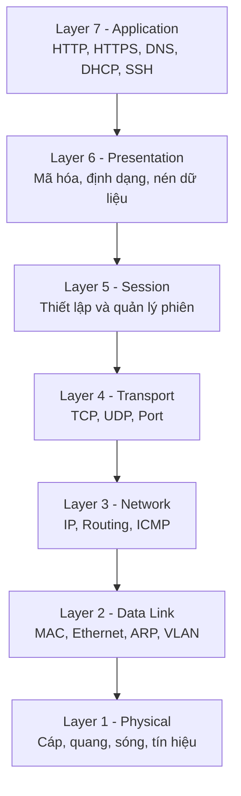
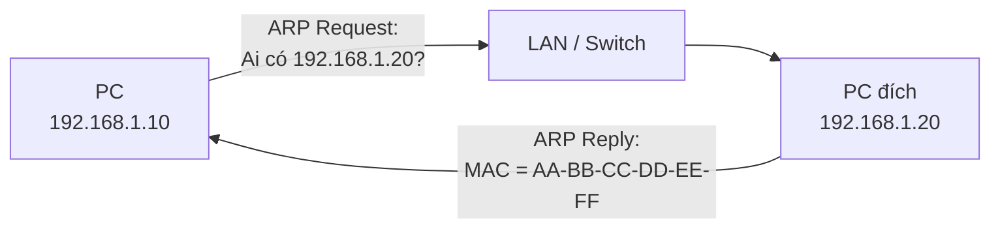
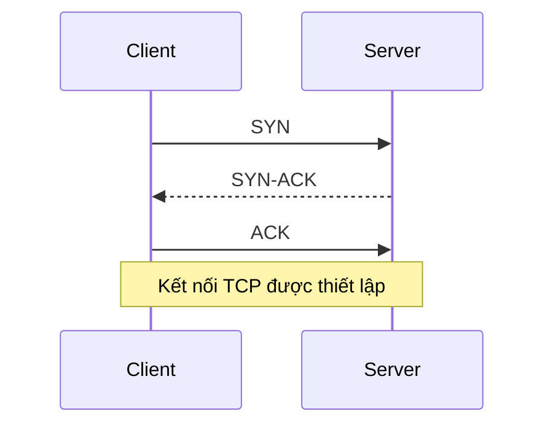
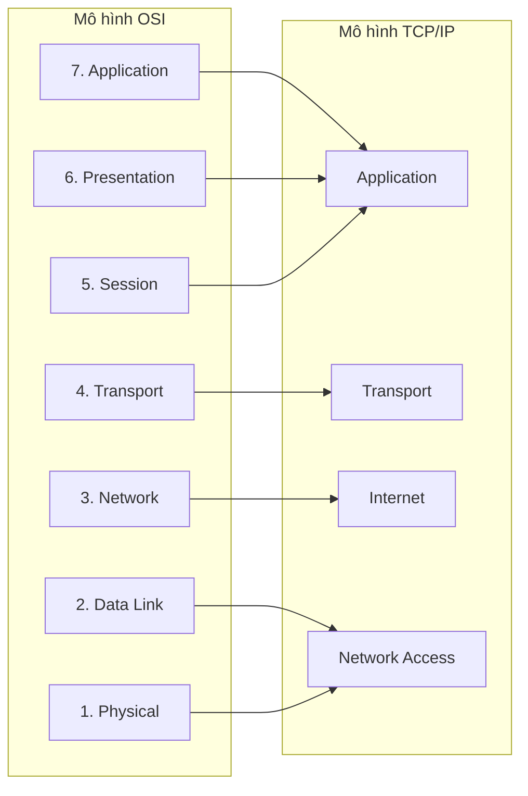
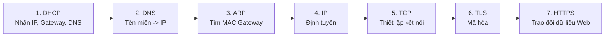
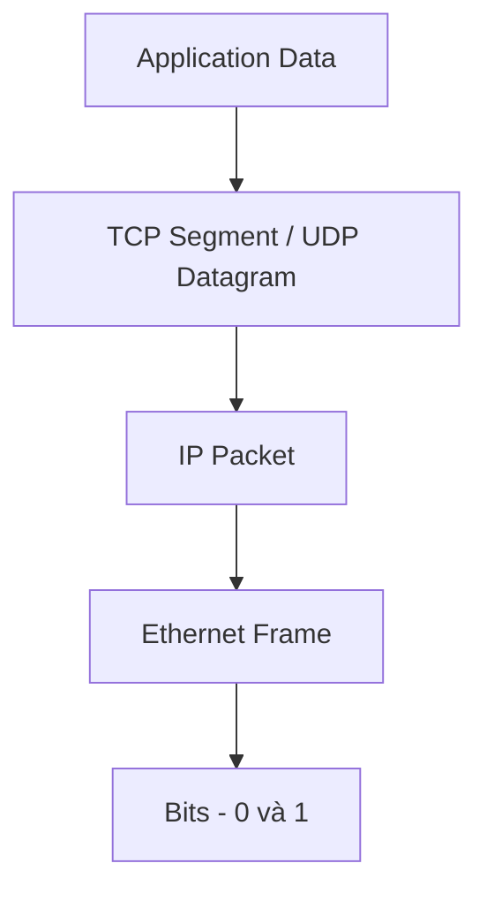

# Mục đích và hoạt động cơ bản của các giao thức trong mô hình OSI và TCP/IP

## 1. Mô hình OSI

Mô hình **OSI (Open Systems Interconnection)** gồm 7 tầng, dùng để mô tả quá trình dữ liệu được truyền từ thiết bị này sang thiết bị khác.



| Tầng | Tên | Chức năng chính | Ví dụ |
|---|---|---|---|
| 7 | Application | Cung cấp dịch vụ mạng cho ứng dụng | HTTP, HTTPS, DNS, DHCP, SSH |
| 6 | Presentation | Định dạng, mã hóa, nén dữ liệu | TLS/SSL, UTF-8, JPEG |
| 5 | Session | Thiết lập, duy trì và kết thúc phiên | Web Session, SSH Session |
| 4 | Transport | Vận chuyển dữ liệu giữa các ứng dụng | TCP, UDP |
| 3 | Network | Địa chỉ IP và định tuyến | IPv4, IPv6, ICMP |
| 2 | Data Link | Truyền dữ liệu trong LAN bằng MAC | Ethernet, ARP, VLAN |
| 1 | Physical | Truyền tín hiệu vật lý | Cáp mạng, cáp quang, Wi-Fi |

---

## 2. Hoạt động cơ bản của từng tầng

### Layer 1 - Physical

Chịu trách nhiệm truyền dữ liệu dưới dạng tín hiệu điện, quang hoặc sóng vô tuyến.

```text
Dữ liệu -> Bit 0 và 1 -> Cáp / Cáp quang / Wi-Fi
```

Ví dụ:

- Cáp mạng Ethernet
- Cáp quang
- Sóng Wi-Fi
- Hub, Repeater

---

### Layer 2 - Data Link

Dùng **địa chỉ MAC** để truyền dữ liệu giữa các thiết bị trong cùng mạng LAN.

Thiết bị điển hình:

```text
Switch
```

Các giao thức/công nghệ phổ biến:

- Ethernet
- ARP
- VLAN
- STP

#### ARP

ARP dùng để tìm địa chỉ MAC tương ứng với một địa chỉ IPv4 trong mạng cục bộ.



Ví dụ:

```text
192.168.1.20 -> AA-BB-CC-DD-EE-FF
```

---

### Layer 3 - Network

Dùng **địa chỉ IP** để xác định thiết bị và định tuyến dữ liệu giữa các mạng.

Thiết bị điển hình:

```text
Router
Layer 3 Switch
Firewall
```

Các giao thức phổ biến:

- IPv4
- IPv6
- ICMP

#### ICMP

ICMP thường được sử dụng để kiểm tra khả năng kết nối và truyền thông báo lỗi mạng.

Ví dụ:

```bash
ping 8.8.8.8
```

---

### Layer 4 - Transport

Có hai giao thức chính:

```text
TCP
UDP
```

#### TCP

TCP là giao thức hướng kết nối, có cơ chế kiểm tra và xác nhận dữ liệu.

Đặc điểm:

- Đảm bảo dữ liệu đến đúng thứ tự
- Có xác nhận
- Có thể truyền lại dữ liệu bị mất
- Độ tin cậy cao

TCP thường thiết lập kết nối bằng **Three-Way Handshake**:



Ví dụ dịch vụ sử dụng TCP:

- HTTP/HTTPS
- SSH
- FTP
- Email

#### UDP

UDP là giao thức không cần thiết lập kết nối trước.

Đặc điểm:

- Nhanh
- Ít overhead
- Không đảm bảo packet đến đích
- Không tự truyền lại packet bị mất

Ví dụ:

- DNS
- DHCP
- VoIP
- Streaming
- Game Online

---

### Layer 5 - Session

Quản lý phiên giao tiếp giữa hai thiết bị hoặc ứng dụng.

Chức năng:

- Tạo phiên
- Duy trì phiên
- Đóng phiên

Ví dụ:

```text
SSH Session
Remote Desktop Session
Web Login Session
```

---

### Layer 6 - Presentation

Chịu trách nhiệm xử lý cách dữ liệu được biểu diễn.

Các chức năng:

- Encoding
- Encryption
- Compression
- Data Format

Ví dụ:

```text
TLS/SSL
UTF-8
JPEG
PNG
JSON
```

---

### Layer 7 - Application

Là tầng gần người dùng và ứng dụng nhất.

| Giao thức | Mục đích | Port thường dùng |
|---|---|---|
| HTTP | Truy cập Web | TCP 80 |
| HTTPS | Web có mã hóa | TCP 443 |
| DNS | Phân giải tên miền thành IP | TCP/UDP 53 |
| DHCP | Cấp cấu hình IP tự động | UDP 67/68 |
| SSH | Quản trị thiết bị từ xa an toàn | TCP 22 |
| Telnet | Quản trị từ xa không mã hóa | TCP 23 |
| FTP | Truyền file | TCP 20/21 |
| SMTP | Gửi Email | TCP 25/465/587 |
| IMAP | Đồng bộ Email | TCP 143/993 |
| POP3 | Nhận Email | TCP 110/995 |
| SNMP | Giám sát thiết bị mạng | UDP 161/162 |
| NTP | Đồng bộ thời gian | UDP 123 |

---

## 3. Mô hình TCP/IP

TCP/IP thường được chia thành 4 tầng.



| TCP/IP | Tương ứng OSI |
|---|---|
| Application | Layer 5, 6, 7 |
| Transport | Layer 4 |
| Internet | Layer 3 |
| Network Access | Layer 1, 2 |

Các giao thức thường gặp:

```text
Application
├── HTTP / HTTPS
├── DNS
├── DHCP
├── SSH
├── FTP
├── SMTP
└── SNMP

Transport
├── TCP
└── UDP

Internet
├── IPv4
├── IPv6
└── ICMP

Network Access
├── Ethernet
├── ARP
├── VLAN
└── Wi-Fi
```

---

## 4. Quá trình truy cập một Website

Ví dụ người dùng truy cập:

```text
https://www.google.com
```



Quá trình cơ bản:

1. **DHCP** cấp IP, Gateway và DNS cho máy tính.
2. **DNS** phân giải tên miền thành địa chỉ IP.
3. **ARP** tìm MAC Address của thiết bị cần giao tiếp trực tiếp, thường là Gateway nếu máy đích ở mạng khác.
4. **IP** xác định Source IP, Destination IP và đường đi.
5. **TCP** thiết lập kết nối.
6. **TLS** thiết lập kênh truyền được mã hóa.
7. **HTTPS** trao đổi nội dung Web.

---

## 5. Quá trình đóng gói dữ liệu

Khi gửi dữ liệu:



Có thể ghi nhớ:

```text
Data
 ↓
Segment / Datagram
 ↓
Packet
 ↓
Frame
 ↓
Bits
```

Khi thiết bị đích nhận dữ liệu, quá trình diễn ra theo chiều ngược lại.

---

## 6. Ghi nhớ nhanh

```text
Layer 7 = Ứng dụng
Layer 6 = Định dạng / mã hóa
Layer 5 = Phiên làm việc
Layer 4 = TCP / UDP / Port
Layer 3 = IP / Routing
Layer 2 = MAC / Switch / VLAN
Layer 1 = Cáp / Sóng / Tín hiệu
```

Cách nhớ đơn giản:

```text
Switch nhìn MAC
Router nhìn IP
TCP/UDP sử dụng Port
Application sử dụng Protocol
```

Các giao thức quan trọng:

```text
HTTP/HTTPS = Web
DNS        = Domain -> IP
DHCP       = Cấp IP tự động
ARP        = IPv4 -> MAC
ICMP       = Kiểm tra / báo lỗi mạng
TCP        = Tin cậy
UDP        = Nhanh
SSH        = Quản trị từ xa an toàn
```

---

