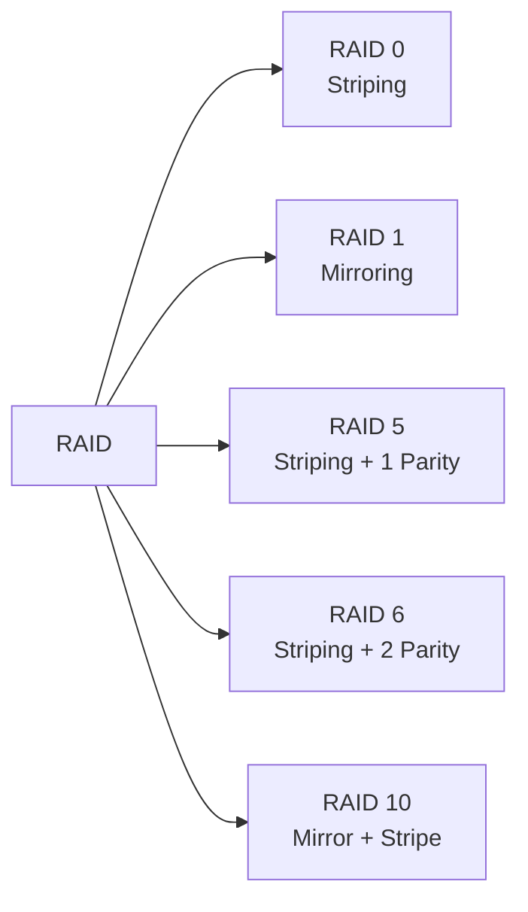
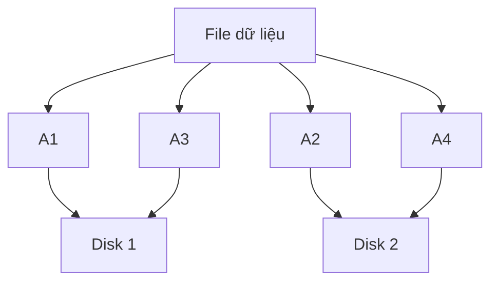
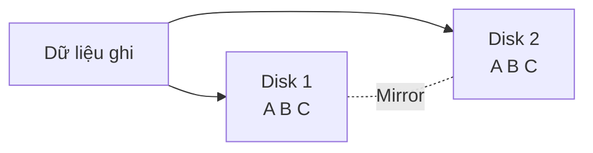
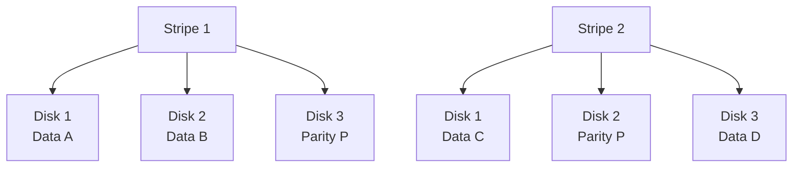
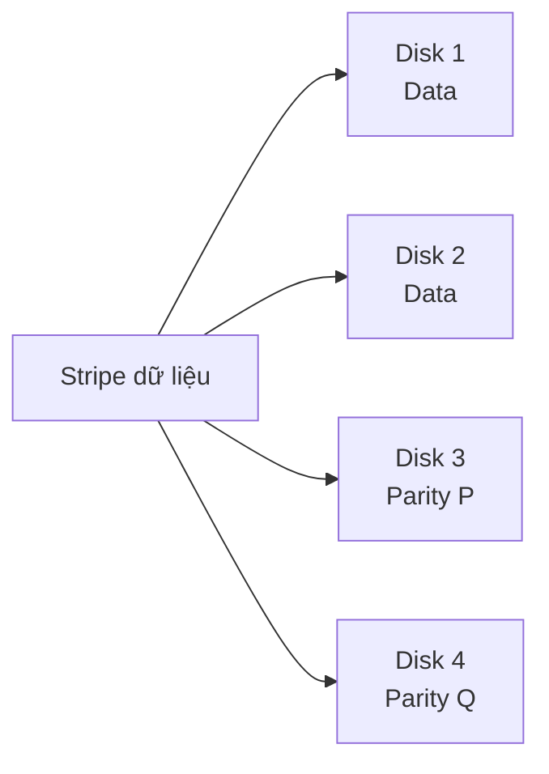
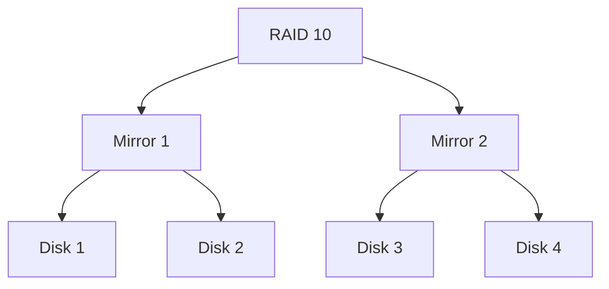
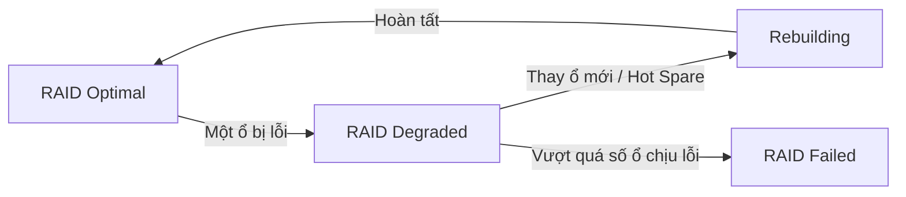
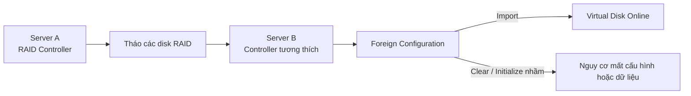

# Tìm hiểu RAID trong máy chủ vật lý

## 1. RAID là gì?

**RAID (Redundant Array of Independent Disks)** là kỹ thuật kết hợp nhiều ổ đĩa vật lý thành một hệ thống lưu trữ logic nhằm:

- Tăng tốc độ đọc/ghi.
- Tăng khả năng chịu lỗi.
- Tối ưu dung lượng lưu trữ.
- Giảm nguy cơ gián đoạn khi một ổ đĩa bị hỏng.

> **Lưu ý:** RAID không thay thế cho Backup.

---

## 2. Các loại RAID phổ biến


### Sơ đồ tổng quan RAID




### RAID 0

**Cơ chế:** Striping – chia dữ liệu và ghi đồng thời lên nhiều ổ.



- Tối thiểu: **2 ổ**
- Dung lượng: **100% tổng dung lượng**
- Đọc: **Rất nhanh**
- Ghi: **Rất nhanh**
- Chịu lỗi: **0 ổ**
- Một ổ hỏng → toàn bộ RAID có thể mất dữ liệu.
- Phù hợp: cache, dữ liệu tạm, workload cần tốc độ cao.

---

### RAID 1

**Cơ chế:** Mirroring – dữ liệu được ghi giống nhau lên hai ổ.



- Tối thiểu: **2 ổ**
- Dung lượng sử dụng: khoảng **50%**
- Đọc: **Tốt**
- Ghi: **Tốt**
- Chịu lỗi: **1 ổ**
- Phù hợp: hệ điều hành, boot volume, server nhỏ.

---

### RAID 5

**Cơ chế:** Striping + 1 parity phân tán.



- Tối thiểu: **3 ổ**
- Dung lượng:

```text
(N - 1) x dung lượng ổ nhỏ nhất
```

- Đọc: **Cao**
- Ghi: **Trung bình**
- Chịu lỗi: **1 ổ**
- Phù hợp: file server, lưu trữ tài liệu, workload thiên về đọc.

---

### RAID 6

**Cơ chế:** Striping + 2 parity.



- Tối thiểu: **4 ổ**
- Dung lượng:

```text
(N - 2) x dung lượng ổ nhỏ nhất
```

- Đọc: **Tốt**
- Ghi: **Chậm hơn RAID 5**
- Chịu lỗi: **2 ổ**
- Phù hợp: NAS, backup server, hệ thống nhiều HDD dung lượng lớn.

---

### RAID 10

**Cơ chế:** RAID 1 + RAID 0, kết hợp Mirror và Striping.



- Tối thiểu: **4 ổ**
- Dung lượng sử dụng: khoảng **50%**
- Đọc: **Rất cao**
- Ghi: **Rất cao**
- Chịu lỗi: ít nhất **1 ổ**, có thể nhiều hơn nếu không cùng cặp mirror.
- Phù hợp: database, máy ảo, VMware, Hyper-V, Proxmox.

---

## 3. Bảng so sánh

| Tiêu chí | RAID 0 | RAID 1 | RAID 5 | RAID 6 | RAID 10 |
|---|---|---|---|---|---|
| Cơ chế | Striping | Mirroring | Striping + 1 parity | Striping + 2 parity | Mirror + Stripe |
| Số ổ tối thiểu | 2 | 2 | 3 | 4 | 4 |
| Dung lượng sử dụng | 100% | ~50% | N-1 | N-2 | ~50% |
| Read Performance | Rất cao | Tốt | Cao | Cao | Rất cao |
| Write Performance | Rất cao | Tốt | Trung bình | Trung bình/Thấp | Rất cao |
| Fault Tolerance | 0 | 1 ổ | 1 ổ | 2 ổ | Tùy vị trí ổ lỗi |
| Ứng dụng | Cache, dữ liệu tạm | OS, boot | File server | Backup, storage lớn | VM, Database |

---

## 4. Thực hành RAID trên máy chủ vật lý

### Bài 1: Tạo các RAID

Lần lượt cấu hình:

```text
RAID 0
RAID 1
RAID 5
RAID 6
RAID 10
```

Ghi lại:

- Số lượng ổ.
- Dung lượng raw.
- Dung lượng usable.
- Stripe size.
- Cache policy.

---

## 5. Kiểm thử hiệu năng

Có thể sử dụng:

### Windows

- CrystalDiskMark
- DiskSpd

### Linux

- `fio`

Các bài test cần thực hiện:

- Sequential Read
- Sequential Write
- Random Read 4K
- Random Write 4K
- IOPS
- Latency

Mẫu bảng kết quả:

| RAID | Seq Read | Seq Write | Random Read IOPS | Random Write IOPS |
|---|---:|---:|---:|---:|
| RAID 0 | | | | |
| RAID 1 | | | | |
| RAID 5 | | | | |
| RAID 6 | | | | |
| RAID 10 | | | | |

---

## 6. Lab khả năng chịu lỗi


### Sơ đồ trạng thái khi ổ đĩa lỗi




### RAID 1

1. Tạo RAID 1 với 2 ổ.
2. Tạo dữ liệu test.
3. Tháo 1 ổ.
4. Kiểm tra trạng thái RAID.

Kết quả mong đợi:

```text
Optimal -> Degraded
```

Dữ liệu vẫn truy cập được.

Sau khi thay ổ:

```text
Degraded -> Rebuilding -> Optimal
```

---

### RAID 5

- Tháo 1 ổ → RAID vẫn hoạt động.
- Tháo thêm ổ thứ 2 → RAID có thể Failed.

---

### RAID 6

- Tháo 1 ổ → vẫn hoạt động.
- Tháo 2 ổ → vẫn hoạt động.
- Mất ổ thứ 3 → RAID Failed.

---

### RAID 10

RAID có thể chịu nhiều ổ lỗi nếu các ổ lỗi không thuộc cùng một cặp mirror.

Ví dụ:

```text
Disk 1 + Disk 3 lỗi -> có thể vẫn chạy
Disk 1 + Disk 2 lỗi -> RAID Failed
```

---

## 7. Hot Spare và Rebuild

**Hot Spare** là ổ dự phòng được controller tự động sử dụng khi một ổ trong RAID bị lỗi.

Quy trình:


Trong quá trình rebuild:

- Hiệu năng giảm.
- Disk load tăng.
- Nguy cơ mất RAID tăng nếu thêm ổ khác bị lỗi.

---

## 8. Chuyển RAID giữa các server


### Sơ đồ chuyển RAID giữa hai server




Khi chuyển ổ RAID từ Server A sang Server B cần kiểm tra:

- RAID Controller có tương thích hay không.
- Firmware.
- RAID Level.
- Disk order.
- Sector size.
- RAID metadata.

Controller có thể hiển thị:

```text
Foreign Configuration
```

Nếu muốn sử dụng RAID cũ, thường phải chọn:

```text
Import Foreign Configuration
```

Không nên chọn:

```text
Clear Foreign
Initialize
Clear Configuration
```

khi chưa chắc chắn, vì có thể làm mất cấu hình hoặc dữ liệu RAID.

---

## 9. Kết luận nhanh

```text
RAID 0  = Nhanh nhất, không có dự phòng.
RAID 1  = An toàn, đơn giản, mất 50% dung lượng.
RAID 5  = Dung lượng tốt, chịu lỗi 1 ổ.
RAID 6  = Chịu lỗi 2 ổ, phù hợp storage lớn.
RAID 10 = Hiệu năng và độ an toàn cao, phù hợp VM/Database.
```

### Gợi ý sử dụng

| Mục đích | RAID đề xuất |
|---|---|
| Hệ điều hành | RAID 1 |
| Database | RAID 10 |
| Virtualization | RAID 10 |
| File Server | RAID 5 / RAID 6 |
| Backup Storage | RAID 6 |
| Dữ liệu tạm | RAID 0 |
