# Tìm hiểu cơ bản về thiết bị mạng

## 1. Modem / ONT

### Modem / ONT là gì?

Modem hoặc ONT là thiết bị nhận đường truyền Internet từ nhà cung cấp dịch vụ như Viettel, VNPT hoặc FPT.

Một số chức năng thường gặp:

- Kết nối Internet qua PPPoE
- NAT
- DHCP
- Phát Wi-Fi
- Bridge Mode
- Chuyển đổi tín hiệu quang sang Ethernet

### Mô hình kết nối

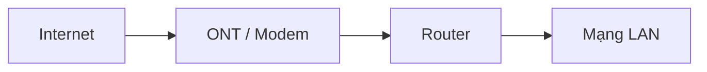

### Ví dụ

- Huawei HG8145V5
- Nokia GPON ONT
- ZTE GPON ONT

---

## 2. Router

### Router là gì?

Router dùng để **kết nối và định tuyến giữa các mạng khác nhau**.

Ví dụ, router có thể kết nối mạng LAN nội bộ với Internet hoặc kết nối hai chi nhánh với nhau.

### Chức năng chính

- Routing
- NAT
- PPPoE
- DHCP Server
- VPN
- Load Balancing
- Policy Routing
- QoS

### Mô hình

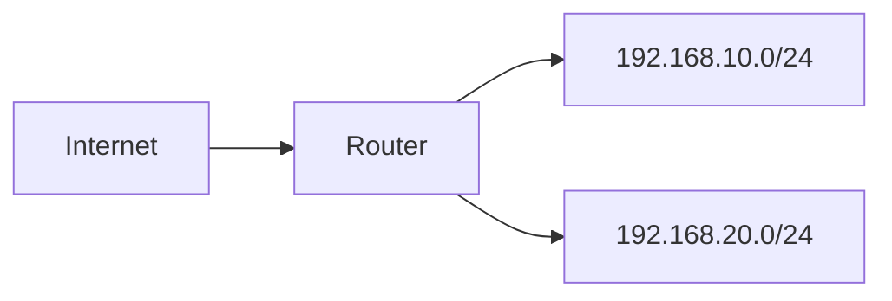

### Một số thiết bị phổ biến

- MikroTik CCR
- TP-Link Omada ER605
- DrayTek Vigor
- Cisco ISR
- Ubiquiti EdgeRouter

---

## 3. Switch

### Switch là gì?

Switch dùng để kết nối nhiều thiết bị trong cùng một mạng LAN.

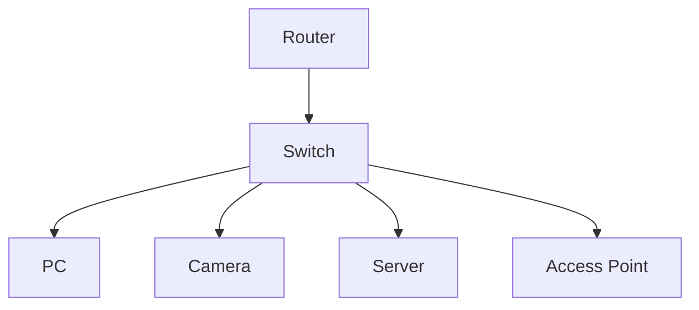

### Unmanaged Switch

Đặc điểm:

- Cắm vào là chạy
- Không cần cấu hình
- Phù hợp mạng nhỏ
- Không quản lý VLAN nâng cao

### Managed Switch

Có thể cấu hình:

- VLAN
- Access Port
- Trunk Port
- STP / RSTP
- LACP
- Port Security
- QoS
- PoE
- SNMP

### Ví dụ VLAN

| VLAN | Mục đích | Ví dụ subnet |
|---|---|---|
| VLAN 10 | Server | 192.168.10.0/24 |
| VLAN 20 | Nhân viên | 192.168.20.0/24 |
| VLAN 30 | Wi-Fi | 192.168.30.0/24 |
| VLAN 40 | Camera | 192.168.40.0/24 |
| VLAN 50 | Guest | 192.168.50.0/24 |

---

## 4. Access Point

### Access Point là gì?

Access Point, viết tắt là **AP**, là thiết bị cung cấp kết nối Wi-Fi cho điện thoại, laptop và các thiết bị không dây khác.

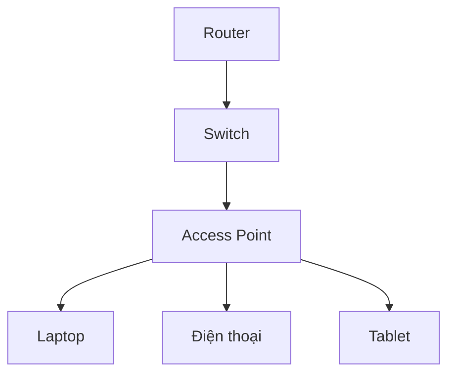

### Các kiến thức quan trọng

- SSID
- 2.4 GHz
- 5 GHz
- 6 GHz
- Channel
- Channel Width
- Transmit Power
- Roaming
- 802.11k/v/r
- Band Steering
- Mesh
- VLAN

### Một số AP phổ biến

- UniFi UAP-AC-LR
- UniFi nanoHD
- UniFi U6
- TP-Link EAP610
- TP-Link EAP653
- Aruba AP

---

## 5. Firewall

### Firewall là gì?

Firewall kiểm soát lưu lượng đi qua hệ thống mạng dựa trên các chính sách bảo mật.

Nó quyết định lưu lượng nào được **Allow** và lưu lượng nào bị **Deny**.

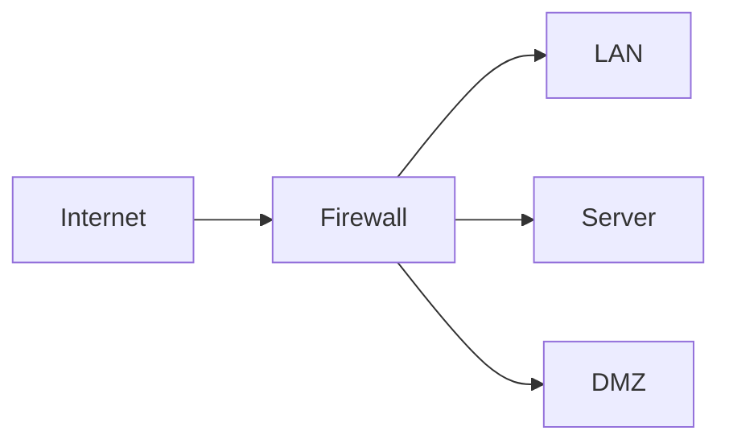

### Chức năng thường gặp

- Firewall Policy
- NAT
- VPN
- IPS
- Web Filtering
- Antivirus
- Application Control
- SSL Inspection
- SD-WAN

### Ví dụ rule

```text
Source      : LAN
Destination : Internet
Service     : HTTP, HTTPS
Action      : Allow
NAT         : Enable
```

### Thiết bị phổ biến

- FortiGate
- Palo Alto
- Sophos Firewall
- pfSense
- OPNsense

---

## 6. Wireless Controller

### Controller là gì?

Wireless Controller giúp quản lý nhiều Access Point tập trung từ một giao diện.

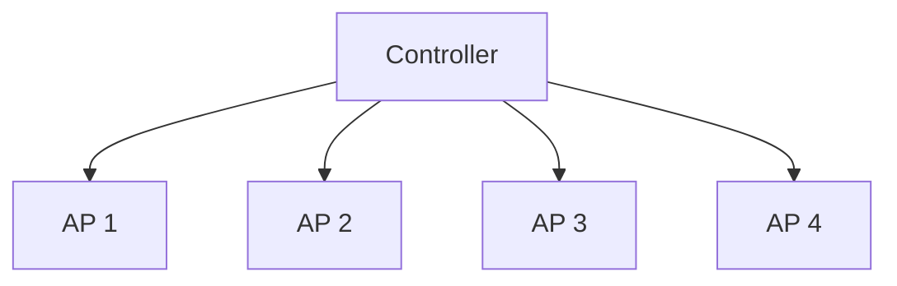

### Controller có thể quản lý

- SSID
- VLAN
- Roaming
- Client
- Channel
- Transmit Power
- Guest Portal
- Mesh
- Firmware

### Ví dụ

- UniFi Network Controller
- TP-Link Omada Controller
- Cisco Wireless LAN Controller
- Aruba Controller

---

## 7. VPN Gateway

### VPN Gateway dùng để làm gì?

VPN Gateway tạo kết nối bảo mật giữa các địa điểm hoặc giữa người dùng từ xa với hệ thống nội bộ.

### Ví dụ Site-to-Site VPN

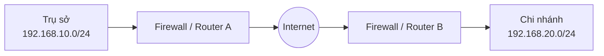

### Công nghệ VPN thường gặp

- IPsec
- SSL VPN
- WireGuard
- OpenVPN
- L2TP

---

## 8. Load Balancer

### Load Balancer là gì?

Load Balancer dùng để chia lưu lượng từ người dùng đến nhiều server khác nhau.

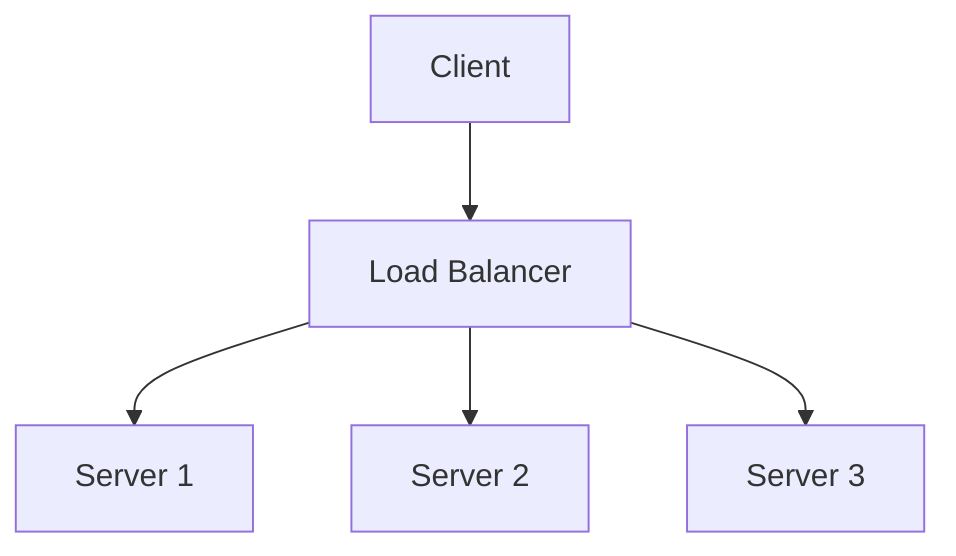

### Lợi ích

- Chia tải
- Tăng khả năng chịu lỗi
- Hỗ trợ High Availability
- Health Check server
- SSL Termination

### Ví dụ

- HAProxy
- Nginx
- F5 BIG-IP
- FortiADC

---

## 9. IDS / IPS

### IDS

IDS là hệ thống **phát hiện xâm nhập**.

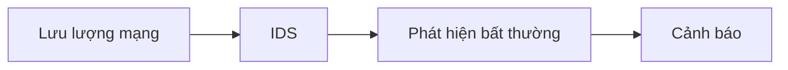

### IPS

IPS không chỉ phát hiện mà còn có thể **ngăn chặn lưu lượng nguy hiểm**.

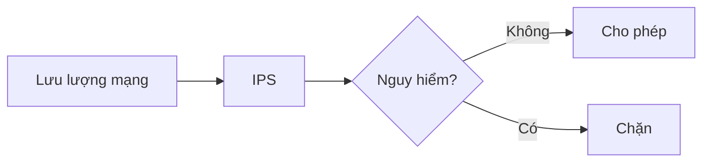

### Ví dụ

- Suricata
- Snort
- FortiGate IPS
- Palo Alto Threat Prevention

---

## 10. Mô hình mạng doanh nghiệp cơ bản

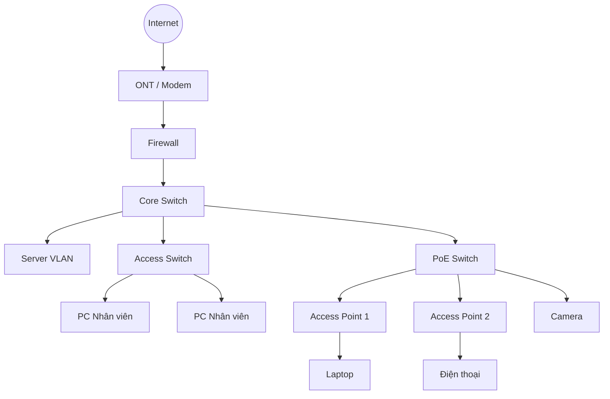

### Gợi ý chia VLAN

```text
VLAN 10  - Server
VLAN 20  - Nhân viên
VLAN 30  - Wi-Fi
VLAN 40  - Camera
VLAN 50  - Guest
VLAN 99  - Management
```

### Luồng hoạt động cơ bản

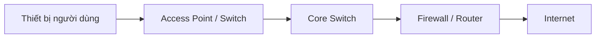

---

## 11. Lộ trình học

Nếu muốn học để làm Network Engineer, có thể đi theo thứ tự sau:

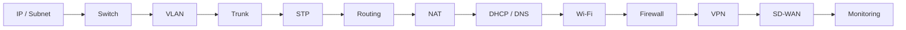

### Kiến thức nên nắm chắc

1. IPv4 và Subnet Mask
2. Default Gateway
3. MAC Address
4. ARP
5. DHCP
6. DNS
7. VLAN
8. Access Port và Trunk Port
9. STP
10. Static Route
11. OSPF
12. NAT
13. Firewall Policy
14. VPN
15. Wi-Fi và Roaming
16. Monitoring và Troubleshooting

---

## Bảng tóm tắt thiết bị

| Thiết bị | Chức năng chính |
|---|---|
| ONT / Modem | Nhận kết nối Internet từ ISP |
| Router | Định tuyến giữa các mạng |
| Switch | Kết nối thiết bị trong LAN |
| Access Point | Cung cấp Wi-Fi |
| Firewall | Kiểm soát và bảo vệ lưu lượng |
| Controller | Quản lý AP tập trung |
| VPN Gateway | Kết nối mạng từ xa an toàn |
| Load Balancer | Chia tải cho nhiều server |
| IDS / IPS | Phát hiện và ngăn chặn tấn công |

---


> **Router định tuyến - Switch kết nối - AP phát Wi-Fi - Firewall bảo vệ.**

Đây là bốn nhóm thiết bị quan trọng nhất cần hiểu trước khi đi sâu vào hệ thống mạng doanh nghiệp.

