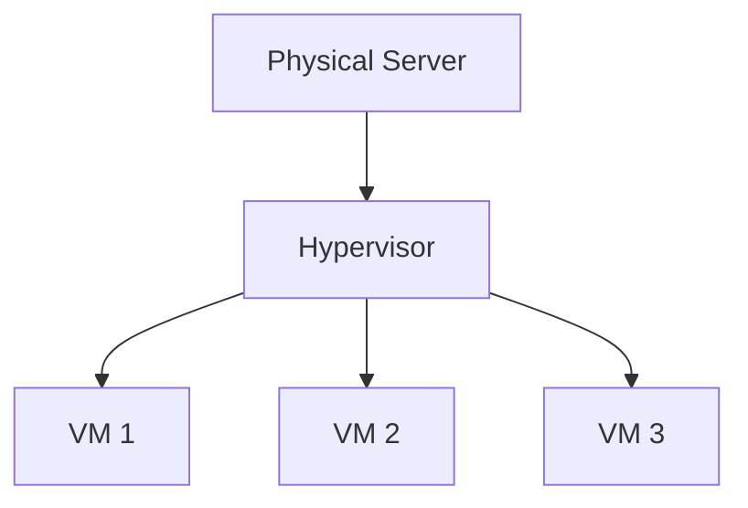
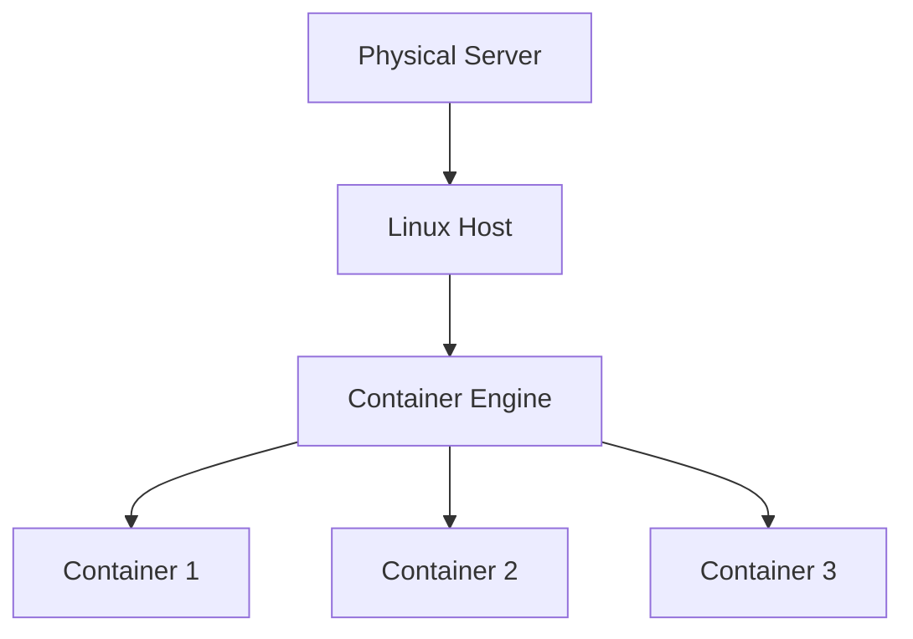
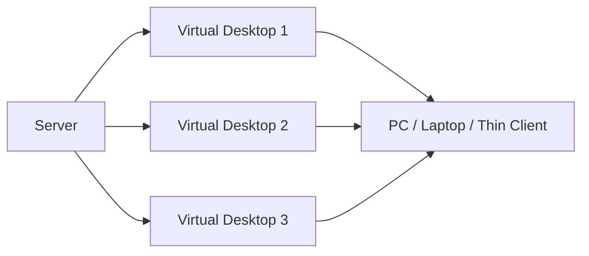
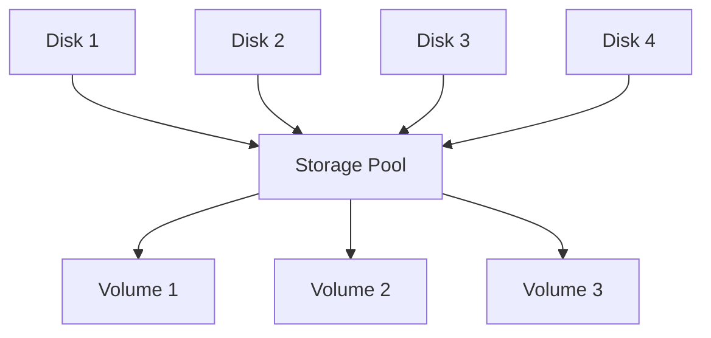
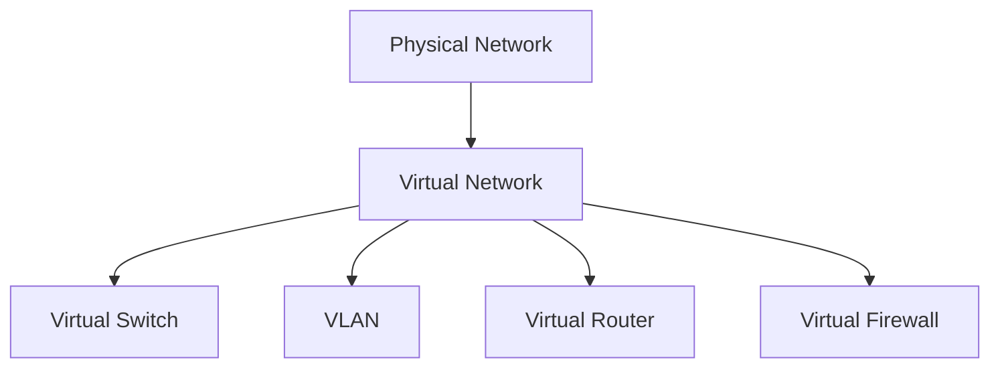

# Tổng quan về ảo hóa

## 1. Ảo hóa là gì?

**Ảo hóa (Virtualization)** là công nghệ cho phép tạo ra các tài nguyên ảo từ một hệ thống phần cứng vật lý.

Thay vì một máy chủ vật lý chỉ chạy một hệ điều hành, ta có thể chia tài nguyên như:

- CPU
- RAM
- Ổ cứng
- Card mạng

để tạo thành nhiều **máy ảo (Virtual Machine - VM)** hoạt động độc lập.

Ví dụ:

```text
Máy chủ vật lý
CPU: 24 Core
RAM: 128 GB
Disk: 4 TB

        ↓ Ảo hóa

VM 1: Windows Server
VM 2: Ubuntu Server
VM 3: Database Server
VM 4: Web Server
```

### Lợi ích của ảo hóa

- Tận dụng tốt tài nguyên máy chủ.
- Giảm số lượng server vật lý.
- Tiết kiệm điện và chi phí vận hành.
- Dễ tạo, xóa và clone máy ảo.
- Dễ backup và snapshot.
- Dễ phục hồi khi xảy ra sự cố.
- Thuận tiện cho lab, test và triển khai hệ thống.

---

## 2. Các loại ảo hóa phổ biến

Có thể chia thành các loại chính:

1. Ảo hóa máy chủ.
2. Ảo hóa hệ điều hành / Container.
3. Ảo hóa Desktop.
4. Ảo hóa ứng dụng.
5. Ảo hóa lưu trữ.
6. Ảo hóa mạng.

---

## 3. Ảo hóa máy chủ - Server Virtualization

Một server vật lý được chia thành nhiều máy ảo.



Các nền tảng phổ biến:

- VMware ESXi
- Microsoft Hyper-V
- Proxmox VE
- KVM
- Xen

### Đặc điểm

- Mỗi VM có hệ điều hành riêng.
- Các VM hoạt động tương đối độc lập.
- Có thể cấp CPU, RAM và Disk riêng.
- Hỗ trợ snapshot, clone và migration.
- Phù hợp cho hệ thống production.

Ví dụ ứng dụng:

```text
VM1 -> Domain Controller
VM2 -> Database
VM3 -> Web Server
VM4 -> File Server
```

---

## 4. Ảo hóa hệ điều hành - Container Virtualization

Container không tạo một máy tính ảo hoàn chỉnh như VM mà dùng chung kernel với hệ điều hành Host.



Công nghệ phổ biến:

- Docker
- LXC
- Podman
- Kubernetes

### Đặc điểm

- Nhẹ hơn máy ảo.
- Khởi động nhanh.
- Tốn ít RAM và CPU.
- Dùng chung kernel với Host.
- Phù hợp DevOps và Microservices.

---

## 5. Ảo hóa Desktop - Desktop Virtualization

Desktop được chạy trên server hoặc trung tâm dữ liệu thay vì trực tiếp trên máy người dùng.



Công nghệ:

- VMware Horizon
- Citrix Virtual Apps and Desktops
- Azure Virtual Desktop
- Windows 365

### Đặc điểm

- Quản lý tập trung.
- Dữ liệu nằm trên server.
- Người dùng có thể truy cập từ nhiều thiết bị.
- Phù hợp doanh nghiệp có nhiều nhân viên.

---

## 6. Ảo hóa ứng dụng - Application Virtualization

Ứng dụng chạy trong môi trường tách biệt mà không cần cài đặt trực tiếp hoàn toàn lên hệ điều hành người dùng.

Công nghệ:

- Microsoft App-V
- Citrix Virtual Apps
- VMware ThinApp

### Đặc điểm

- Hạn chế xung đột phần mềm.
- Dễ triển khai ứng dụng.
- Quản lý tập trung.
- Giảm việc cài ứng dụng thủ công trên từng máy.

---

## 7. Ảo hóa lưu trữ - Storage Virtualization

Nhiều thiết bị lưu trữ vật lý được gom thành một hệ thống lưu trữ logic.



Công nghệ liên quan:

- SAN
- NAS
- Ceph
- VMware vSAN
- ZFS Storage Pool

### Đặc điểm

- Quản lý dung lượng tập trung.
- Dễ mở rộng.
- Có thể tăng khả năng dự phòng.
- Cho phép nhiều server sử dụng chung storage.

---

## 8. Ảo hóa mạng - Network Virtualization

Cho phép tạo các thành phần mạng bằng phần mềm thay vì chỉ phụ thuộc vào thiết bị vật lý.



Công nghệ:

- VMware NSX
- Open vSwitch
- VLAN
- VXLAN
- SDN

### Đặc điểm

- Tạo mạng logic linh hoạt.
- Dễ chia VLAN.
- Dễ cô lập các VM.
- Có thể tạo router và firewall ảo.
- Phù hợp Cloud và Data Center.

---

## 9. Phân loại Hypervisor

### Type 1 - Bare-metal

Hypervisor chạy trực tiếp trên phần cứng.

```text
Hardware
   ↓
Hypervisor
   ↓
Virtual Machine
```

Ví dụ:

- VMware ESXi
- Microsoft Hyper-V
- Proxmox VE
- Xen

#### Đặc điểm

- Hiệu năng cao.
- Ổn định.
- Phù hợp Production.
- Quản lý được nhiều VM.

---

### Type 2 - Hosted

Hypervisor chạy trên một hệ điều hành đã được cài sẵn.

```text
Hardware
   ↓
Windows / Linux
   ↓
Hypervisor
   ↓
Virtual Machine
```

Ví dụ:

- VMware Workstation
- VirtualBox
- Parallels Desktop

#### Đặc điểm

- Dễ cài đặt.
- Phù hợp học tập và lab.
- Hiệu năng thấp hơn Type 1.
- Phụ thuộc hệ điều hành Host.

---

## 10. Bảng so sánh các loại ảo hóa

| Loại | Đối tượng được ảo hóa | Ví dụ | Đặc điểm |
|---|---|---|---|
| Server Virtualization | Máy chủ | VMware, Proxmox, Hyper-V | Tạo nhiều VM |
| Container | Hệ điều hành | Docker, LXC | Nhẹ, nhanh |
| Desktop Virtualization | Desktop | Citrix, Horizon | Desktop chạy từ xa |
| Application Virtualization | Ứng dụng | App-V, ThinApp | Chạy app tách biệt |
| Storage Virtualization | Lưu trữ | Ceph, vSAN, ZFS | Gom nhiều disk/storage |
| Network Virtualization | Mạng | NSX, VLAN, VXLAN | Tạo mạng logic |

---

